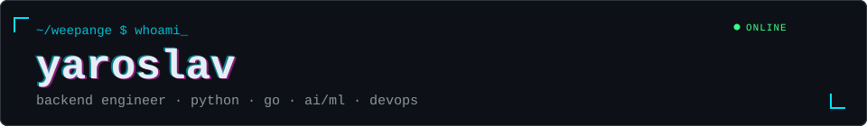
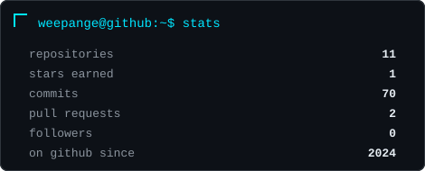
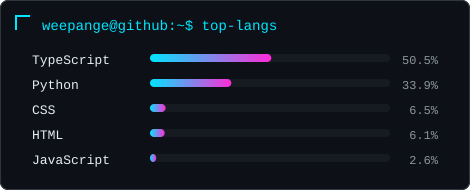

<p align="center">
  <samp>
    <a href="https://t.me/weepange">telegram</a> .
    <a href="#stack">stack</a> .
    <a href="#projects">projects</a> .
    <a href="#stats">stats</a>
  </samp>
</p>

I'm a junior backend engineer studying Applied Informatics at Southern Federal University. I learn by building: real cases, hackathons, startup projects. I like reliable APIs, clean architecture, and knowing what the software actually runs on.

Я бэкенд-разработчик (junior), учусь в ЮФУ на прикладной информатике. Учусь на практике: кейсы, хакатоны, стартапы. Люблю надёжные API и понимать, на чём всё работает.

```text
now       learning Go, backend architecture, deployment
daily     Debian Linux, Python, Docker
looking   open source, real engineering tasks
```


## stack

**Languages** <sub>python (confident) · go (learning) · c++ and sql (basics)</sub><br/>


**Backend** <br/>


**Data** <br/>


**Infra & tools** <br/>


## projects

| Project | What it is | Stack |
|:--|:--|:--|
| **FlyGuard** <sub>(Lidar_Muha)</sub> | LCT 2026 hackathon, Moscow Metro case. Detects foreign objects in a tunnel from Hesai Pandar128 point clouds; the pipeline is modeled on Drosophila brain circuits. |    |
| **LocalSpeaking** | Discord-style real-time chat with a REST API and WebSocket messaging. |   |
| **Lotus IT Academy Hackathon** | AI retrieval with local Qwen3-0.6B, hybrid and vector search, reranking. |   |
| **Flower Shop** | University coursework web app with a product catalog and database layer. |   |


## stats





<picture>
  <source media="(prefers-color-scheme: dark)" srcset="https://raw.githubusercontent.com/weepange/weepange/output/github-contribution-grid-snake-dark.svg" />
  
</picture>


## contact

[](https://t.me/weepange)

<br/>

<a href="https://github.com/kittinan/spotify-github-profile">
  
</a>


